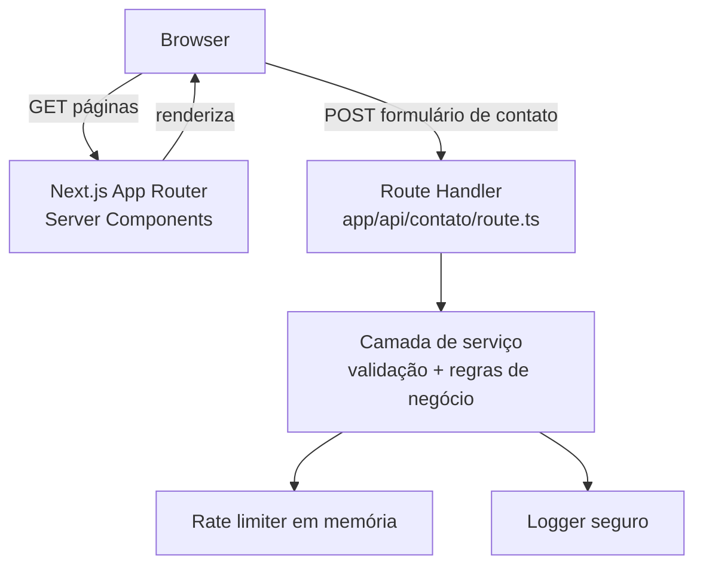

# Arquitetura



Nesta fase não há banco de dados nem repositório de persistência — o
formulário de contato é validado, sanitizado e logado de forma segura, sem
armazenamento estruturado. Caso surja a necessidade real de persistir leads
(ver `docs/produto/ROADMAP.md`, Fase 6), a camada `Repository → MySQL`
descrita no prompt mestre será adicionada e este diagrama será atualizado.

## Camadas do site

```text
Browser
   ↓
Next.js (App Router, Server Components por padrão)
   ↓
Route Handler (app/api/contato) — apenas para o formulário de contato
   ↓
Service (validação Zod, sanitização, regras de negócio)
   ↓
Rate limiter em memória + Logger seguro
```
