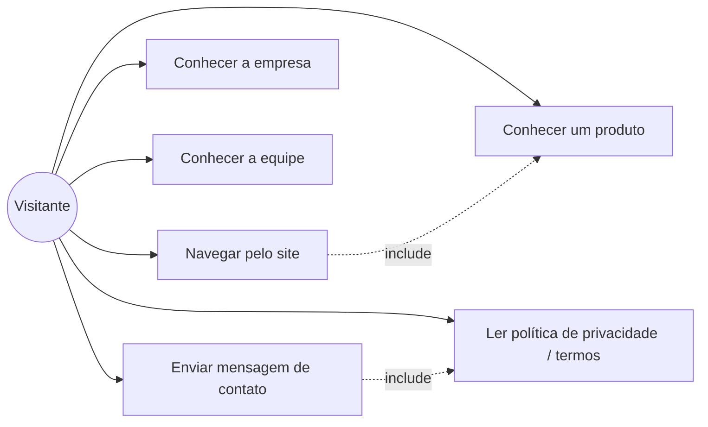

# Casos de Uso

## UC5 — Enviar mensagem de contato (detalhado)

**Ator primário:** Visitante
**Pré-condição:** Visitante está em `/contato`.
**Fluxo principal:**
1. Visitante preenche nome, e-mail, empresa (opcional), telefone (opcional),
   assunto, produto de interesse e mensagem.
2. Visitante marca o consentimento de privacidade.
3. Visitante envia o formulário.
4. Sistema valida no client (feedback imediato) e reenvia ao servidor.
5. Servidor revalida todos os campos, sanitiza e verifica rate limit.
6. Servidor confirma sucesso; UI exibe mensagem de confirmação.

**Fluxos alternativos:**
- 4a. Campo obrigatório inválido → erro específico exibido, sem envio.
- 5a. Payload malicioso/malformado → servidor rejeita com erro genérico.
- 5b. Limite de envios excedido → servidor responde 429.
