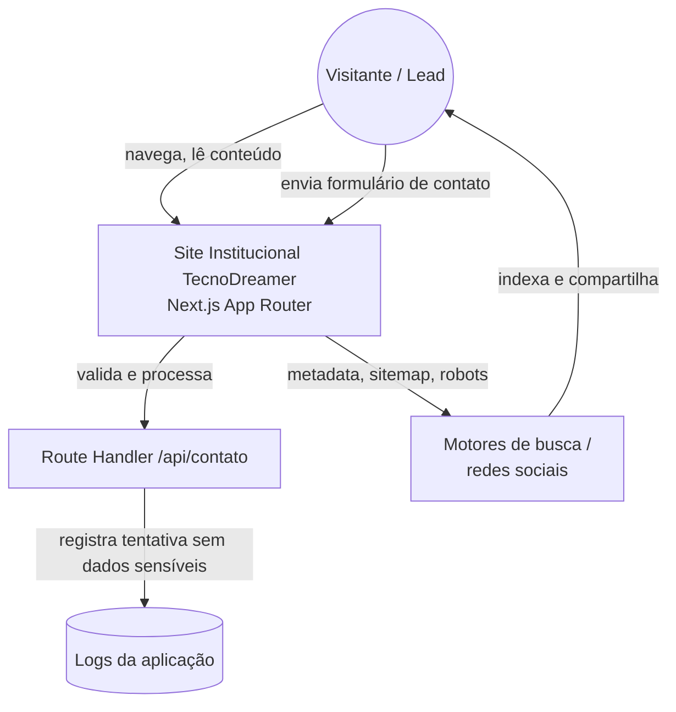

# Diagrama de Contexto

O site institucional é o único sistema desta fase. Não há integração com os
produtos (Gestão Pet, PetConnect, Marketing Analytics) — eles são apenas
apresentados como conteúdo. Não há banco de dados nesta fase inicial.
